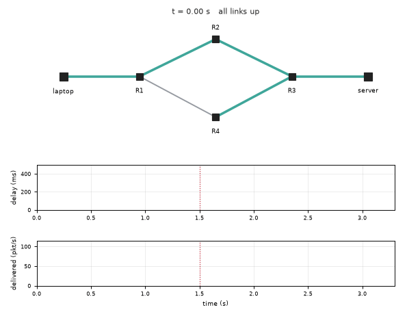
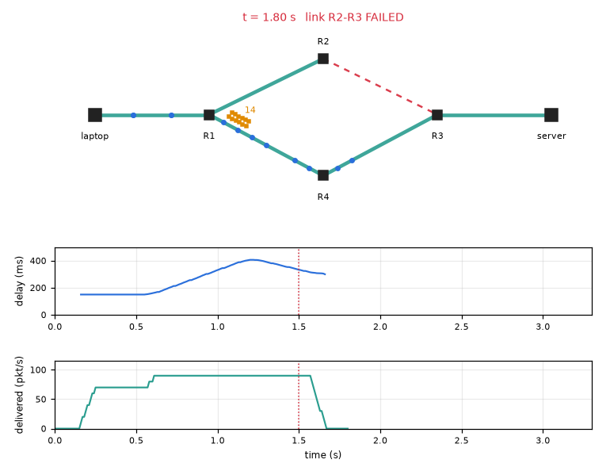
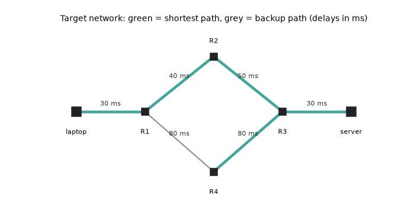

# What you are building toward

A small network of routers is shown as a graph. Packets travel as dots from a laptop to a server along the shortest path, queues fill in front of the busiest link, and a link then fails. For a moment packets are lost, then the routers learn the news and the traffic moves to the longer backup path. A live chart under the graph shows the delay jumping up and the throughput dipping and recovering. Your goal over the coming sessions: build this live simulator yourself, and then add the parts that real networks use, such as routers that talk to each other.

*Target: packets cross a network, a link fails, traffic re-routes, and the delay and throughput chart reacts*

*Target still: queue filling in front of a link and the live chart below*

*The Target network: primary path, backup path and link delays*

These results come from a private reference build. The code is not published; the roadmap shows the path so you can build your own.

Live links:

- [Math Visual Studio (playground)](https://krunalpanchal1995.github.io/studio/)
