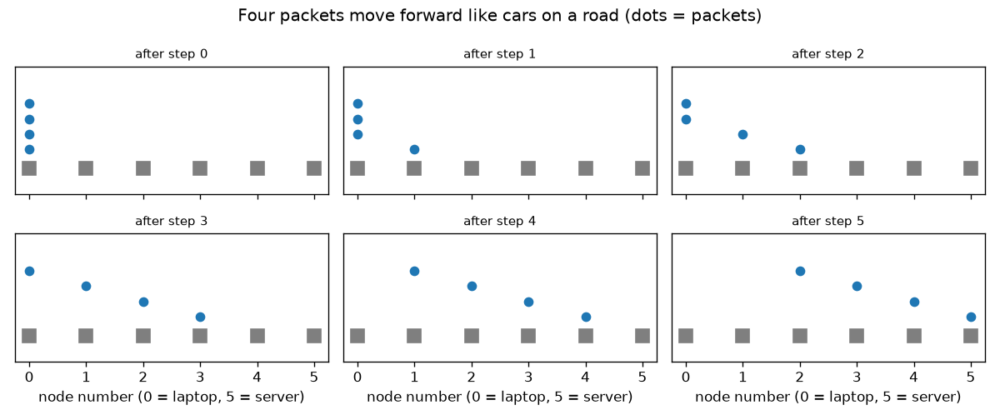
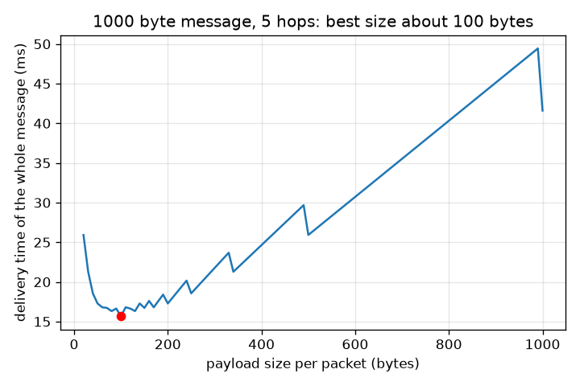

# Session 1: A message is cut into packets that hop from router to router

*Level 1 (conceptual interactive model) · about 60 minutes · openpacket*

> This is a simplified educational model. It is not a validated design tool and must not be used for real structures, electrical installations, vehicles, industrial processes or medical decisions.

**Prerequisites**

- Counting, division and rounding up.
- You have read PRIMER.md and run `python start.py 1` once.

**Learning objectives.** After this session you can:

- Explain why a message is cut into numbered packets and what a label (header) is for.
- Cut a message into packets and rebuild it, even when packets arrive in the wrong order.
- Follow a route hop by hop using only next-hop tables.
- Count the time steps a message needs with steps = hops + packets - 1, and explain why very small and very large packets are both slow.

## A. Real-world problem
When you open a web page the server does not send it in one piece. The page is cut into many small packets. Each packet is labelled with where it is going and which piece it is, and routers pass it on from one to the next, like post offices passing a parcel. Why not send the whole page in one go? And how small should the pieces be? (This is a simplified educational model of the internet.)

## B. Concept and theory
A message of M bytes is cut into packets of at most s bytes of payload, so the number of packets is N = ceil(M / s): round up, because the last packet may be shorter. Every packet also carries a label (header) of h bytes with the addresses and the sequence number; here h = 40 bytes. Each router knows only the next hop for each destination, never the whole path. A link carries one packet at a time and a router can pass a packet on only after receiving all of it (store and forward). Let one step be the time one packet needs to cross one link. The first packet needs H steps for H hops and every other packet arrives one step after the one before it, so the whole message needs H + N - 1 steps. One step lasts (s + h) * 8 / R seconds on a link of R bit/s, which gives the delivery time.

| Symbol | Meaning | Unit |
|---|---|---|
| M | message size | bytes |
| s | payload per packet | bytes |
| h | label (header) per packet, 40 here | bytes |
| N | number of packets | no unit |
| H | number of hops (links) on the route | no unit |
| R | link rate, 1 000 000 here | bit/s |
| T | delivery time of the whole message | s or ms |

**Assumptions**

- All links have the same rate and carry one packet at a time.
- Routers pass a packet on only after receiving all of it.
- There is no waiting for other users' traffic and no loss.
- Wire (propagation) delay is ignored in this session; Session 2 adds it.

$$ N=\left\lceil \frac{M}{s}\right\rceil $$

$$ \text{steps}=H+N-1 $$

$$ T=(H+N-1)\,\frac{8\,(s+h)}{R} $$

## C. Visual explanation
The first figure shows four packets on a route of five hops, one picture per time step: the packets follow each other like cars on a road, each one step behind the one in front. The second figure plots the delivery time of a 1000 byte message over 5 hops against the payload size. Tiny packets need many steps and waste bytes on labels; one huge packet makes every step long and nothing can overlap; the best size is about 100 bytes.

*Four packets crossing five hops, one picture per step: they follow each other like cars on a road.*

*Delivery time of a 1000 byte message over 5 hops: lowest near 100 bytes of payload.*

## D. Interactive simulation
Run the lesson (`python start.py 1`), then open the live app: [Session 1: cut a message into packets](https://krunalpanchal1995.github.io/openpacket/session-01/) (or `app.html` in this folder). Change the message size, packet size and number of hops. In the route view watch the number of packets and steps; in the graph view see where the curve is lowest.

**Challenge.** Deliver the 1000 byte message over 5 hops in under 16 ms.

## E. Worked example and experiment
**Problem.** A 1000 byte message is sent in packets of 300 bytes of payload over 3 hops. Links run at 1 Mbit/s and every packet has a 40 byte label. How many packets are there, how many steps, and how long does the delivery take?

1. N = ceil(1000 / 300) = ceil(3.33) = 4 packets (300, 300, 300 and 100 bytes).
2. Steps = H + N - 1 = 3 + 4 - 1 = 6.
3. One step = (300 + 40) * 8 / 1 000 000 = 0.00272 s = 2.72 ms.
4. T = 6 * 2.72 ms = 16.32 ms.
5. Check by simulation: journey_steps(4, 3) moves the packets one step at a time and also gives 6.

**Answer.** 4 packets, 6 steps and 16.32 ms.

**Experiment.** Cut a sheet of paper into 4 strips, number them, shuffle them, and hand them one by one along a row of 3 friends; each friend may pass on only one strip per turn. Count the turns until all strips reach the end: you should get 6. Real networks differ: routers also wait for other people's packets, links have wire delay, and packets can be lost, which this model leaves out.

## F. Assessment and design challenge
**Question type A: Conceptual.** Why does every packet carry a sequence number? What goes wrong without it?

Hint

Packets may take different routes or queue for different times.

Step-by-step solution

Different packets can take different routes or wait in different queues, so they can arrive in a different order from the one in which they were sent. The sequence number lets the receiver sort them and rebuild the message; it also shows which packet is missing. Without it the receiver would have to trust the arrival order, and the page would be garbled.

**Question type B: Numerical.** A 900 byte message is sent in packets of 250 bytes of payload over 4 hops at 1 Mbit/s, with a 40 byte label per packet. Find the number of packets, their sizes, the steps and the delivery time.

Hint

Round up for N; one step is (s + h) * 8 / R.

Step-by-step solution

N = ceil(900 / 250) = ceil(3.6) = 4 packets of 250, 250, 250 and 150 bytes. Steps = 4 + 4 - 1 = 7. One step = (250 + 40) * 8 / 1 000 000 = 2.32 ms, so T = 7 * 2.32 = 16.24 ms. (The last packet is shorter, so the real time is a little less; the model charges every packet full size.) Sanity check: the answer is close to the worked example, which has a similar size.

**Question type C: Graph and simulation interpretation.** In the graph of delivery time against payload size (1000 byte message, 5 hops), the time is 25.92 ms for 20 byte packets, 15.68 ms for 100 byte packets and 41.6 ms for one 1000 byte packet. Explain the shape of the curve.

Hint

Two effects pull in opposite directions: the number of steps and the length of one step.

Step-by-step solution

With tiny packets there are many packets, so many steps, and a large share of every packet is label: 20 byte packets need 50 packets, 54 steps, each only 60 bytes long. With one huge packet there are only 5 steps but each one carries 1040 bytes and nothing overlaps, because only one link is busy at a time. In between, packets follow each other and the links work in parallel, and the curve has its lowest point near 100 bytes. The minimum is flat-ish: sizes near 100 are all good.

**Question type D: Design and optimisation challenge.** Design: for the 1000 byte message over 5 hops, compare payloads of 50, 100, 200 and 500 bytes and choose one. What would make you choose a larger size in real life?

Hint

Compute N, steps and T for each size.

Step-by-step solution

50 bytes: 20 packets, 24 steps, 17.28 ms. 100 bytes: 10 packets, 14 steps, 15.68 ms. 200 bytes: 5 packets, 9 steps, 17.28 ms. 500 bytes: 2 packets, 6 steps, 25.92 ms. Best is 100 bytes. In real life routers also spend effort on every packet, so fewer packets save work, and real labels are a smaller share of a bigger packet; but a lost packet then costs more to resend. The trade-off is why real packets are about 1500 bytes, not 100.

Score yourself with [RUBRIC.md](../../RUBRIC.md). Print the [activity sheet](activity_sheet.md) to work on paper.

## Common misconceptions
| Common misconception | What is actually true |
|---|---|
| A message travels along the wire as one block. | It is cut into packets and each packet is passed on separately, so different packets of the same message can be on different links at the same time. |
| Every router knows the whole path to the destination. | Each router knows only the next hop for each destination; the route appears from many small decisions. |
| Smaller packets are always faster because they are smaller. | Each packet carries a fixed label, and there are more steps to count; very small packets can be slower than medium ones. |
| Packets always arrive in the order they were sent. | They can arrive in any order, which is why they carry a sequence number. |

## Glossary
- **packet**: a small piece of a message with a label saying where it goes and which piece it is
- **header**: the label at the front of a packet (addresses, sequence number, checksum)
- **payload**: the part of a packet that carries the message itself
- **router**: a device that receives packets and passes each one on towards its destination
- **hop**: one link between two neighbouring nodes on a route
- **next hop**: the neighbour to which a router passes a packet for a given destination
- **store and forward**: a router receives the whole packet before it passes it on

## Finish
1. Do the three coding tasks in [exercises.md](exercises.md).
2. Run `python start.py 1` again after your changes. It ends with the checkpoint; when it prints `PASS`, you are done. (Checkpoint only: `python start.py check 1`.)

Next: [Session 2](../session-02/README.md)
