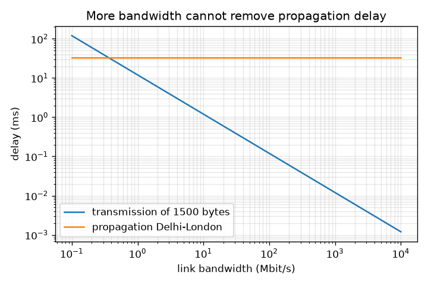
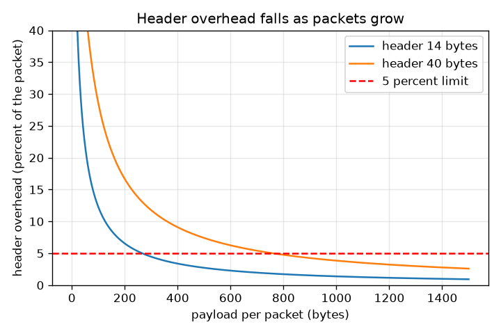

# Session 2: The mathematics of a packet: headers, addresses, routing tables and delay

*Level 2 (mathematical engineering model) · about 75 minutes · openpacket*

> This is a simplified educational model. It is not a validated design tool and must not be used for real structures, electrical installations, vehicles, industrial processes or medical decisions.

**Prerequisites**

- Session 1: packets, headers and hops.
- Powers of two and the idea of a binary number (explained in Section B).

**Learning objectives.** After this session you can:

- Build a toy packet from bytes with a header, a payload and a checksum.
- Convert IPv4 addresses between dotted decimal and a 32-bit integer, and use bit masks for subnets.
- Implement longest-prefix-match routing and test it on a small table.
- Add propagation, transmission and queueing delay and compute the minimum round-trip time from Delhi to London.
- Choose a packet size that keeps the header overhead below 5 percent.

## A. Real-world problem
A packet must say who sent it, where it is going, which piece of the message it is, and carry a check so that damage can be noticed. That costs bytes. Then every router must choose the next hop for it within a tiny fraction of a second, and the trip takes time that no technology can shrink below the speed of light in fibre. How large is the header overhead? How does a router choose? How fast can a packet get from Delhi to London? (Simplified educational model: the toy header is not the real IPv4 header.)

## B. Concept and theory
An IPv4 address is four bytes, so it is a 32-bit number: 192.168.1.20 is 192*256^3 + 168*256^2 + 1*256 + 20 = 3232235796. A subnet written 192.168.1.0/24 fixes the first 24 bits (the network) and leaves 8 bits for hosts, so it holds 2^8 = 256 addresses. The mask has 24 ones followed by zeros; an address is inside when (address AND mask) equals the network. A router table has rows (prefix, next hop); when several rows match, the router uses the one with the longest prefix, and 0.0.0.0/0 is the default route. A toy packet has a 14 byte header (source 4, destination 4, sequence 2, payload length 2, checksum 2) followed by the payload; the checksum adds all 16-bit words, folds the carries and flips the bits so that a receiver adding everything gets all ones. The one-way delay over a link is propagation (distance divided by the signal speed, about 2e8 m/s in fibre, two thirds of the speed of light in vacuum) plus transmission (bits divided by bandwidth) plus queueing. The smallest possible round trip is twice the distance divided by the signal speed. The header overhead for header h and payload p is h / (h + p), which is below a limit x when p > h (1 - x) / x.

| Symbol | Meaning | Unit |
|---|---|---|
| a | IPv4 address as a number | no unit (0 to 2^32 - 1) |
| n | prefix length of a subnet | bits |
| d | distance along the link | m |
| v | signal speed in fibre, about 2e8 | m/s |
| L | packet size in bits | bit |
| B | link bandwidth | bit/s |
| q | queueing delay | s |
| h, p | header and payload size | bytes |
| x | overhead limit (0.05) | no unit |

**Assumptions**

- Signals travel at 2e8 m/s in glass; real cables run longer than the straight great-circle distance, so real delays are larger.
- The toy header is simplified; real IPv4 headers have 20 bytes or more.
- Queueing delay is given as a number here; Session 3 simulates it.
- The great-circle distance uses an Earth radius of 6371 km.

$$ a=a_1\,2^{24}+a_2\,2^{16}+a_3\,2^{8}+a_4 $$

$$ \text{inside}\iff (a\ \&\ \text{mask}_n)=\text{network},\qquad \text{size}=2^{32-n} $$

$$ t_{\text{one-way}}=\frac{d}{v}+\frac{L}{B}+q,\qquad \text{RTT}_{\min}=\frac{2d}{v} $$

$$ \text{overhead}=\frac{h}{h+p}<x\iff p>\frac{h\,(1-x)}{x} $$

## C. Visual explanation
The first figure plots header overhead against payload size for the 14 byte toy header and a 40 byte header (typical for IPv4 plus a transport header): both curves fall as packets grow and cross the red 5 percent line at 267 and 761 bytes of payload. The second figure uses log axes to compare transmission time of a 1500 byte packet with the Delhi to London propagation delay: transmission shrinks as bandwidth grows, but propagation stays at 33.6 ms, so more bandwidth cannot reduce the round-trip time below the limit set by distance.

*Transmission delay of a 1500 byte packet against bandwidth, and the fixed Delhi to London propagation delay.*

*Header overhead against payload: the 5 percent line is crossed at 267 bytes (14 byte header) and 761 bytes (40 byte header).*

## D. Interactive simulation
Run the lesson (`python start.py 2`), then open the live app: [Session 2: header overhead and the delay budget](https://krunalpanchal1995.github.io/openpacket/session-02/) (or `app.html` in this folder). Change payload, header, bandwidth and distance. In the packet view see the header share of the packet, in the overhead graph find where the curve meets the 5 percent line, and in the delay graph see propagation and transmission add up.

**Challenge.** Get the header overhead below 5 percent and the transmission delay below 0.1 ms.

## E. Worked example and experiment
**Problem.** A 1500 byte packet crosses Delhi to London (6712 km great-circle distance) on a 100 Mbit/s link and waits 2 ms in queues. Find the propagation, transmission and total one-way delay, and the minimum round-trip time.

1. Propagation = d / v = 6.712e6 m / 2e8 m/s = 0.03356 s = 33.56 ms.
2. Transmission = L / B = (1500 * 8 bits) / 100e6 bit/s = 12000 / 1e8 = 0.00012 s = 0.12 ms.
3. Queueing = 2 ms (given).
4. Total one-way = 33.56 + 0.12 + 2 = 35.68 ms.
5. Minimum round trip = 2 d / v = 2 * 33.56 = 67.12 ms (no queueing, zero-size packet).

**Answer.** Propagation 33.56 ms, transmission 0.12 ms, total one-way 35.68 ms, minimum round trip 67.12 ms.

**Experiment.** Run the ping command from your computer to a nearby server and to one on another continent (your operating system has `ping`). Compare the round-trip times with 2 d / v. Real values are higher: cables are longer than the great-circle distance, and every router adds transmission and queueing. They can never be lower than the minimum, which is why a result below it would mean you have measured a nearby copy of the server (a content delivery network).

## F. Assessment and design challenge
**Question type A: Conceptual.** Why must a router use the longest matching prefix rather than the first or shortest match? Give an example with the table in the lesson.

Hint

A short prefix like 10.0.0.0/8 covers many addresses, including ones that have a more specific row.

Step-by-step solution

A longer prefix describes a smaller, more specific group of addresses, so it carries more precise information about where the address really is. 10.1.2.77 matches /0, /8, /16 and /24 rows; only the /24 row says it is in the lab, so the packet must go to the lab. If the router took the first or shortest match it would send it to the ISP or the corporate gateway, and the specific rows would never be used. The default route 0.0.0.0/0 is used only when nothing else matches.

**Question type B: Numerical.** How many addresses does a /20 subnet hold? Is 10.1.15.200 inside 10.1.0.0/20? Is 10.1.16.0?

Hint

Size is 2 to the power (32 - 20). A /20 fixes the first 20 bits, so the third number is fixed in blocks of 16.

Step-by-step solution

Size = 2^(32 - 20) = 2^12 = 4096 addresses. The /20 covers 10.1.0.0 to 10.1.15.255 (the third number from 0 to 15). So 10.1.15.200 is inside, and 10.1.16.0 is just outside. Check: the mask is 255.255.240.0 and 15 AND 240 = 0, while 16 AND 240 = 16.

**Question type C: Graph and simulation interpretation.** In the overhead graph, at about what payload do the toy header (14 bytes) and the 40 byte header cross the 5 percent line? What does a flat tail of the curve tell you?

Hint

Solve h / (h + p) = 0.05 for p.

Step-by-step solution

p = h (1 - 0.05) / 0.05 = 19 h. For h = 14 that is 266 bytes (exactly 5 percent), so 267 bytes is the first whole number below the limit. For h = 40 it is 760 (exactly 5 percent), so 761 bytes is the first below. The tail is flat because adding payload to an already large packet saves very little overhead, while it makes each packet slower to send and costlier to resend.

**Question type D: Design and optimisation challenge.** Design: the header is 40 bytes, the link is 1 Mbit/s and the transmission time of one packet must not exceed 10 ms. Overhead must be below 5 percent. Which payload sizes are allowed? Which would you choose?

Hint

The overhead gives a minimum payload; the transmission limit gives a maximum: (p + 40) * 8 / 1e6 <= 0.010.

Step-by-step solution

Overhead: p >= 761 bytes. Transmission: p + 40 <= 10 ms * 1 Mbit/s / 8 = 1250 bytes, so p <= 1210 bytes. Allowed range: 761 to 1210 bytes. A choice near the upper end, such as 1000 bytes, keeps overhead low (3.85 percent) with some margin on the delay limit. The trade-off: larger packets have lower overhead but a lost packet costs more to resend and each packet blocks the link longer for others.

Score yourself with [RUBRIC.md](../../RUBRIC.md). Print the [activity sheet](activity_sheet.md) to work on paper.

## Common misconceptions
| Common misconception | What is actually true |
|---|---|
| An IP address is a name, like a word. | It is a 32-bit number written as four bytes in dotted decimal; the dots are only for human reading. |
| More bandwidth always means a faster connection. | Bandwidth shortens transmission time only. Propagation delay depends on distance and stays the same: more bandwidth cannot take a Delhi to London round trip below 67.12 ms. |
| A /24 means 24 addresses. | It means the first 24 bits are fixed, which leaves 8 host bits and 2^8 = 256 addresses. |
| A checksum can repair a damaged packet. | The checksum only detects most damage; the receiver then asks for a new copy or drops the packet. |

## Glossary
- **IPv4 address**: a 32-bit number that names a network interface, written as four bytes such as 192.168.1.20
- **subnet**: a block of addresses that share the same first n bits
- **mask**: a 32-bit number with ones for the network bits and zeros for the host bits
- **longest-prefix match**: choosing the routing table row whose prefix matches the address and is longest
- **checksum**: a small number computed from the data so that most damage can be detected
- **propagation delay**: time for the signal to travel the distance
- **transmission delay**: time to push all the bits of a packet onto the link
- **queueing delay**: time a packet waits behind other packets
- **round-trip time (RTT)**: time from sending a packet to receiving the reply

## Finish
1. Do the three coding tasks in [exercises.md](exercises.md).
2. Run `python start.py 2` again after your changes. It ends with the checkpoint; when it prints `PASS`, you are done. (Checkpoint only: `python start.py check 2`.)

Next: [Session 3](../session-03/README.md)
