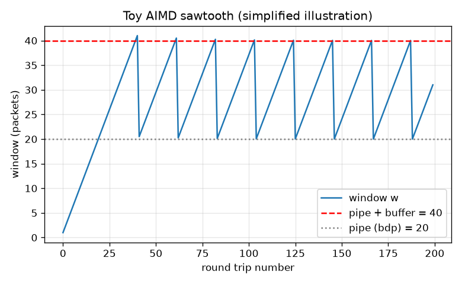
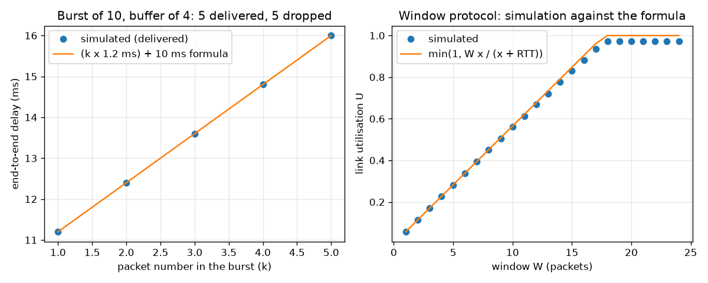
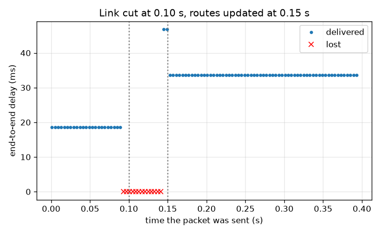

# Session 3: A tiny network simulator: queues, loss, failures and validation

*Level 3 (simulation and validation) · about 90 minutes · openpacket*

> This is a simplified educational model. It is not a validated design tool and must not be used for real structures, electrical installations, vehicles, industrial processes or medical decisions.

**Prerequisites**

- Session 1: packets and hops.
- Session 2: propagation, transmission and queueing delay.

**Learning objectives.** After this session you can:

- Write Dijkstra's algorithm and use it to build routing tables.
- Simulate packets forwarded hop by hop through finite queues, and check the measured delay against the analytic sum.
- Verify the stop-and-wait utilisation formula and the effect of a window, and see retransmission repair loss.
- Simulate a link failure with re-routing, a routing loop and a missing route, and check that packets are conserved.
- Choose a buffer size and a packet size for a video stream and justify them.

## A. Real-world problem
Real networks are too big and too fast to watch, and you must not experiment on them. So we build a toy one inside the computer: routers are points on a graph, links have a delay and a bandwidth, and packets move hop by hop through queues. It uses no sockets and sends nothing anywhere, it is pure arithmetic. Can a simple simulator reproduce the delay formulas exactly? What happens when a buffer fills, a link is cut, or two routers send a packet in circles? (Simplified educational model, not a validated tool for designing real networks.)

## B. Concept and theory
Routing tables come from Dijkstra's algorithm: keep the cheapest known cost to every node, always expand the cheapest unexpanded node, and record for every destination the first hop. The simulator is event-driven: time jumps from event to event (a packet arrives, a transmission ends). Each directed link has a transmitter that sends one packet at a time (L/R seconds), a queue that holds at most B waiting packets (a packet that finds it full is dropped), and a wire delay d. A packet also has a time to live (TTL) that falls by one at every router, so a routing loop ends. A burst of n packets of size L sent at once into one link of rate R is delayed by k L/R plus d for the k-th packet, so queueing adds L/R for each packet ahead. With a finite buffer B, 1 + B packets of the burst get through and the rest are dropped. For reliable delivery a sender with window W sends W packets, waits for acknowledgements and resends after a timeout. With x = L/R and RTT the time from the end of sending a packet to the arrival of its acknowledgement, a window W uses the link a fraction U = min(1, W x / (x + RTT)) of the time; stop-and-wait is W = 1. If each transmission is lost with probability p, a packet needs 1/(1-p) transmissions on average. At every moment packets are conserved: sent = delivered + dropped + in flight. A toy congestion window (a simplified illustration, not real TCP) grows by 1 per round trip and halves when the pipe and buffer overflow; its average is about three quarters of its peak.

| Symbol | Meaning | Unit |
|---|---|---|
| x = L/R | time to send one packet | s |
| d | wire delay of a link | s |
| B | buffer: packets allowed to wait | packets |
| W | window: packets sent before waiting | packets |
| RTT | time from end of sending to the acknowledgement arriving | s |
| U | fraction of time the link is busy | no unit |
| p | probability that a transmission is lost | no unit |
| TTL | hops a packet may still make | no unit |

**Assumptions**

- Link costs for routing are the delay of a 12000 bit packet on an empty link.
- Routers share the same global picture when they recompute routes (a real network uses a protocol to spread it).
- A cut link drops its queue and the packet being sent; packets already on the wire still arrive.
- Acknowledgements are small packets of 400 bits and are never lost.
- Everything is a simplified educational model: no real packets or sockets are used.

$$ D(v)=\min_{u}\big(D(u)+c(u,v)\big)\quad\text{(Dijkstra: cheapest cost to node }v\text{)} $$

$$ t_k=k\,\frac{L}{R}+d,\qquad k=1,2,\dots,1+B\quad\text{(burst into one link)} $$

$$ U=\min\!\left(1,\ \frac{W\,x}{x+\mathrm{RTT}}\right),\qquad x=\frac{L}{R} $$

$$ E[\text{transmissions}]=\frac{1}{1-p},\qquad \text{sent}=\text{delivered}+\text{dropped}+\text{in flight} $$

## C. Visual explanation
The first figure has two panels. Left: a burst of 10 packets into a link with a buffer of 4. Five packets arrive, at delays that climb by 1.2 ms per packet along the formula line, and the other five are dropped. Right: the utilisation of a window protocol measured in the simulator lies on the formula curve, rising by one step of 0.0565 per unit of window until the pipe is full at a window of 18. The second figure shows a steady flow when the link between R1 and R2 is cut at 0.10 s and routes are updated at 0.15 s: delays are 18.6 ms, then packets are lost for a while (red crosses), then delays settle at 33.6 ms on the longer backup path. The third figure is the toy AIMD sawtooth between 20 and 40 packets.

*Toy AIMD window (simplified illustration): sawtooth between about 20 and 40 packets.*

*Left: burst of 10 into a buffer of 4, simulated delays on the formula line. Right: window utilisation, simulation against the formula.*

*A steady flow when a link is cut at 0.10 s and routes are updated at 0.15 s: delay jumps from 18.6 to 33.6 ms; lost packets in between.*

## D. Interactive simulation
Run the lesson (`python start.py 3`), then open the live app: [Session 3: a burst meets a buffer, and a window fills a pipe](https://krunalpanchal1995.github.io/openpacket/session-03/) (or `app.html` in this folder). Set the burst and buffer sliders and watch how many packets get through and how many are dropped; then switch to the graph and change the window and the round-trip time.

**Challenge.** Lose no packet from the burst (burst at most buffer + 1) and keep the link at least 90 percent busy.

## E. Worked example and experiment
**Problem.** A burst of 10 packets of 1500 bytes (12000 bits) is sent at once into a link of 10 Mbit/s with 10 ms wire delay and a buffer of 4 waiting packets. How many arrive, how many are dropped, and what is the delay of the last one that arrives?

1. Time to send one packet x = 12000 / 10e6 = 0.0012 s = 1.2 ms.
2. The first packet goes straight onto the wire; the next 4 wait in the buffer; the other 5 find it full and are dropped.
3. So 1 + 4 = 5 packets arrive, 5 are dropped.
4. The k-th packet finishes sending at k * 1.2 ms and arrives 10 ms later, so its delay is k * 1.2 + 10 ms.
5. The last one (k = 5) has delay 5 * 1.2 + 10 = 16.0 ms, of which queueing is 4 * 1.2 = 4.8 ms.

**Answer.** 5 arrive and 5 are dropped; the last delivered packet has a delay of 16.0 ms, including 4.8 ms of queueing.

**Experiment.** Look at a supermarket with one cashier and a rope that holds 4 people: when 10 people arrive together, 5 can be served or wait and 5 walk away. Real routers behave similarly when a burst meets a full buffer. Real traffic is not a single burst, buffers hold bytes rather than packets, and senders react to loss, which the simulator leaves out. Compare your own measured ping times on a busy link with an idle one to see queueing delay add to the minimum.

## Real-world application and mini-project: Size the buffer and the packets for a video stream
A camera sends 25 frames per second over one link of 5 Mbit/s with 10 ms delay. Each frame is 20000 bytes of payload that the camera cuts into packets (payload P bytes plus a 40 byte header) and sends all at once. The router at the other end of the link has memory for 16 waiting packets. Use `video_trial` and `smallest_payload` from Session 3 to find the smallest payload that loses nothing, check that the header overhead is below 5 percent, and check that no frame takes longer than 45 ms.

**Deliverable:** A script that prints, for payloads 761, 1000, 1176 and 1177 bytes, the packets per frame, the number of packets dropped, the worst frame delay and the header overhead, names the smallest loss-free payload for 16 buffer slots, and saves a picture of dropped packets against payload size.

**Success looks like:** The smallest loss-free payload is reported (it is 1177 bytes: 17 packets per frame), with overhead 3.29 percent and worst frame delay 43.10 ms, and payload 1176 is shown to lose one packet from every frame.

## F. Assessment and design challenge
**Question type A: Conceptual.** Why is stop-and-wait very inefficient on a link with a long delay, and what does a window change?

Hint

Think about how much of the time the sender is waiting for acknowledgements.

Step-by-step solution

In stop-and-wait the sender sends one packet and then waits for the acknowledgement, so most of each cycle is idle waiting; the link is busy only for x out of every x + RTT. A window lets the sender keep W packets in flight, so it fills the waiting time with more packets. The utilisation rises in proportion to W until the pipe is full. The price is more memory at the sender and more packets to resend when something is lost.

**Question type B: Numerical.** A sender uses stop-and-wait with 1500 byte packets on a 10 Mbit/s link; the RTT after sending is 20.04 ms. Find x, U and the throughput. Which window fills the pipe?

Hint

x = L / R; U = x / (x + RTT); throughput = U * R.

Step-by-step solution

x = 12000 / 10e6 = 1.2 ms. U = 1.2 / (1.2 + 20.04) = 0.0565. Throughput = 0.0565 * 10 Mbit/s = 0.565 Mbit/s. The window that fills the pipe is the smallest W with W x >= x + RTT: W >= 21.24 / 1.2 = 17.7, so W = 18. Sanity check: U must be at most 1, and it is far below it, as expected for a long delay.

**Question type C: Graph and simulation interpretation.** In the re-routing graph, read the delay before the cut, after re-routing, and the number of lost packets. Why are exactly those packets lost, and how many would be lost if the failure were detected after 0.025 s instead of 0.05 s?

Hint

Packets are lost if they reach router R1 while its table still points at the broken link (and one is lost while being sent when the link breaks).

Step-by-step solution

Before the cut the delay is 18.6 ms (three links of 5 ms wire plus 1.2 ms sending each), after re-routing it is 33.6 ms (three links of 10 ms plus 1.2 ms each). 13 packets are lost: those that reach R1 from 1.2 ms before the cut until the tables are updated 0.05 s later, a window of about 51 ms with one packet every 4 ms. With a detection time of 0.025 s the window is about 26 ms and 7 packets are lost. The lost number is about the detection time divided by the packet interval, which is why fast failure detection matters.

**Question type D: Design and optimisation challenge.** Design: the router is upgraded from 16 to 20 buffer slots. A 20000 byte video frame is sent as one burst; each packet has a 40 byte header. What is the smallest payload that loses nothing now, and what happens with a payload of 761 bytes?

Hint

A frame of n packets needs n - 1 waiting slots. Find the smallest payload with n <= 21.

Step-by-step solution

With 20 slots the frame can have at most 21 packets: n = ceil(20000 / P) <= 21 needs P >= 953 (20000 / 21 = 952.4, so P = 953). Its overhead is 40 / 993 = 4.03 percent. With payload 761 there are 27 packets and 26 slots would be needed, so 6 packets of every frame are lost with 20 slots. Trade-off: smaller packets give a finer-grained loss but need more buffer for a burst; larger packets save header bytes but one loss destroys more data.

Score yourself with [RUBRIC.md](../../RUBRIC.md). Print the [activity sheet](activity_sheet.md) to work on paper.

## Common misconceptions
| Common misconception | What is actually true |
|---|---|
| A bigger buffer always fixes packet loss. | A bigger buffer absorbs bursts but also adds waiting time; every packet in a full buffer waits behind all the others. The right size depends on the burst and on the delay you can accept. |
| Dropping a packet means the message is lost. | A reliable protocol notices the missing acknowledgement and resends the packet; the cost is time, not data. |
| If a link fails, the network stops working. | Routers can compute another path and use it, but packets sent during the detection time are lost and the new path is usually longer. |
| A routing loop only wastes a little time. | A looping packet occupies links over and over; without a time-to-live limit it would never leave, and loops can cause congestion. |

## Glossary
- **Dijkstra's algorithm**: a method that finds the cheapest path from one node to all others by always expanding the cheapest unexpanded node
- **buffer**: the memory in a router that holds packets waiting for a link
- **tail drop**: the rule that a packet arriving at a full buffer is dropped
- **acknowledgement (ACK)**: a small packet that tells the sender a packet arrived
- **timeout**: the time after which an unacknowledged packet is sent again
- **window**: the number of packets a sender may have in flight without an acknowledgement
- **time to live (TTL)**: a counter that falls at every router and drops the packet at zero
- **utilisation**: the fraction of time a link is busy sending
- **AIMD**: additive increase, multiplicative decrease: add one per round trip, halve on loss

## Finish
1. Do the three coding tasks in [exercises.md](exercises.md).
2. Run `python start.py 3` again after your changes. It ends with the checkpoint; when it prints `PASS`, you are done. (Checkpoint only: `python start.py check 3`.)

Next: the [roadmap](../../promo/roadmap.md). Session 4 is yours to build.
